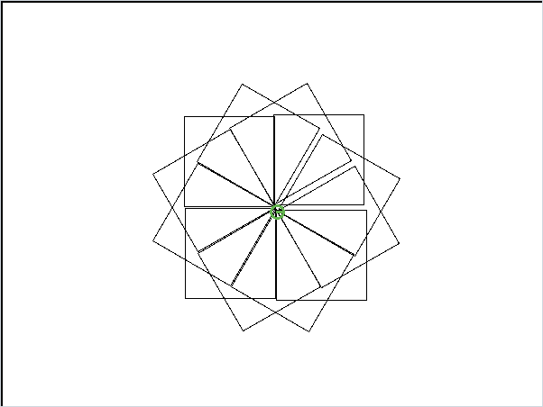
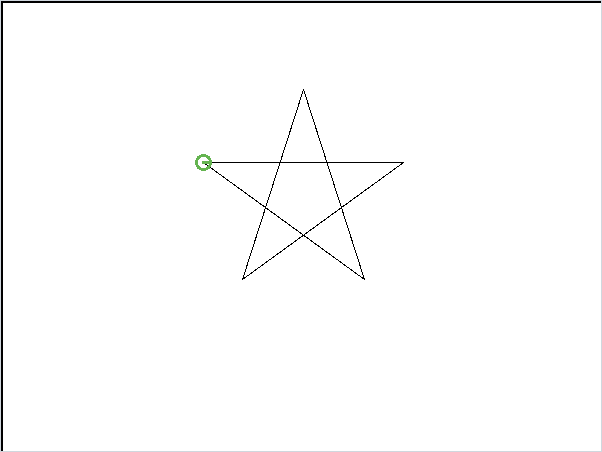
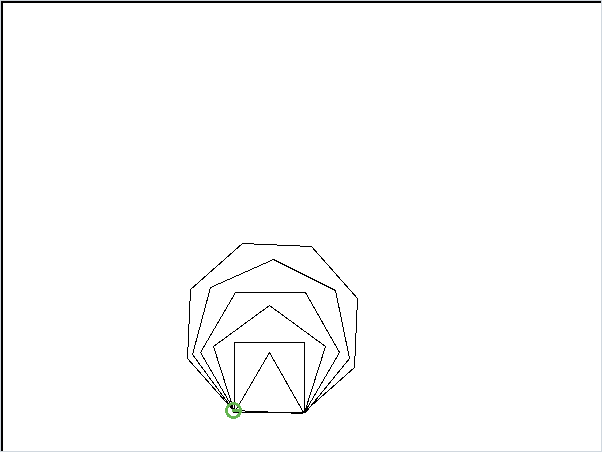
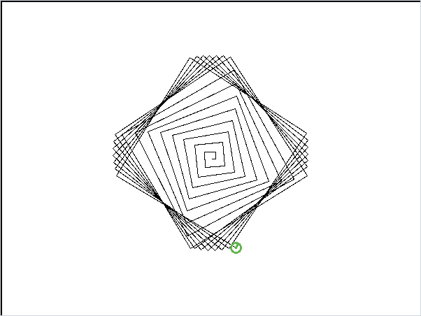

# Logo Interpreter

A Logo interpreter written in OCaml with ocamllex and ocamlyacc, made with Adnane Serrai for our language theory course. You type turtle commands, the program parses them, runs them and draws the result.

| `rosace.logo` | `etoile.logo` | `polygones.logo` | `spirale.logo` |
|---|---|---|---|
|  |  |  |  |

I worked on expressions, variables, loops, conditions and error recovery.

## The language

```logo
Def n 3 ;
Repete 6 [
  Repete :n [Avance 70 ; Gauche (360 / :n)] ;
  Def n (:n + 1)
] .
```

- Moves: `Avance`, `Recule`, `Gauche`, `Droite` (angles in degrees)
- Pen: `Dessine` (pen down), `Deplace` (pen up), `Efface`
- Variables: `Def x 10`, then `:x`
- Arithmetic in parentheses: `(:x + 1)`, `(360 / :n)`
- Loops: `Repete n [ ... ]`
- Conditions: `Si (:x > 2) Alors ... Sinon ... FinSi`
- `;` separates instructions, `.` runs the program

Errors (unknown token, syntax error, undefined variable, division by zero) are reported and the REPL keeps going.

## Build and run

Needs OCaml (`ocamlc`, `ocamllex`, `ocamlyacc`) and GNU Make.

```sh
cd src
make
./repl_logo < ../examples/etoile.logo
```

`repl_logo` uses a text turtle that prints its position after each program. For the drawing window, install the OCaml `graphics` library (`opam install graphics`) and run:

```sh
make graphic
./repl_logo_graphic
```

## Repository layout

- `src/`: final version of the interpreter.
- `examples/`: example programs (the pictures above).
- `history/`: the intermediate versions from each exercise (`Exo01`, `Exo02`, `Exo03`), kept to show how the interpreter was built step by step. Some of them are partial.
- `history/starter-files/`: files given with the assignment (REPL skeleton, turtle modules). `src/turtle_graphic.ml` comes from there.

## Tests

```sh
python3 tests/check.py
```

Builds every version (history and final), runs the examples and checks calculations, conditions, loops and recovery after errors. The graphical window is not tested.

## License

MIT for our code. The files in `history/starter-files/` (and `src/turtle_graphic.ml`) were provided by the course teachers and are not covered by this license.
